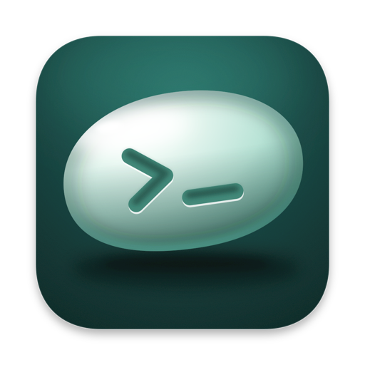

# Oblyn

A code editor for the Mac, built around your projects and the terminals you keep open for them.

This repository holds Oblyn's releases. Download the latest `Oblyn-<version>.dmg` from
[Releases](https://github.com/haseebyousuf/oblyn-releases/releases/latest), open it and drag Oblyn into
Applications. It needs macOS 14 or later.

Once it's installed, Oblyn keeps itself up to date: it checks for new versions every few hours, or whenever you
choose Check for Updates… in the Oblyn menu.

© Haseeb Yousuf. All rights reserved.
